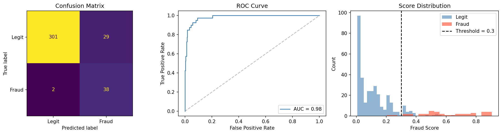

# FraudCast

UPI / Google Pay transaction fraud detection — personal finance data, no external APIs.

**Paper:** *Fraudcast: UPI Anomaly Detector*, presented at ICERI-2025 (9th International Conference on Engineering Research and Innovations, Mumbai University & ICT Academy), March 2025.

## Results

On a held-out test set (strict time-based split, transactions after 1 July 2023):

| Metric | Value |
|---|---|
| Fraud caught | **38 of 40 (95% recall)** |
| ROC AUC | **0.98** |
| Precision at threshold 0.30 | 56.7% (29 false positives out of 330 legit) |



The threshold favours recall: missing a fraud costs more than reviewing a false alarm. At 0.35, precision rises to 73% with the same recall. See [report.md](report.md) for the full method and threshold comparison.

**About the data:** my own Google Pay export (699 real transactions, Oct 2021 – Mar 2024) plus 80 synthesised fraud cases across four attack patterns. The raw data contains personal payment history, so it is not in this repo, and the notebooks' outputs and example coordinates have been cleared or replaced.

## What it does

Scores any UPI transaction through a three-stage pipeline and returns a fraud probability between 0 and 1:

| Stage | Model | Weight |
|-------|-------|--------|
| Isolation Forest | Anomaly detection on amount + time-of-day features | 25% |
| Location Check | Haversine distance → implied travel speed (≥ 150 km/h flags fraud) | 20% |
| AWF Classifier | GradientBoosting + GaussianNB + SVC ensemble trained with SMOTE | 55% |

Threshold is **0.30** — transactions scoring above are flagged FRAUD.

## Stack

- **ML pipeline** — Python 3, scikit-learn, imbalanced-learn, pandas/numpy
- **Backend** — FastAPI + uvicorn
- **Frontend** — React 18 + Vite + TypeScript + Tailwind CSS + TanStack Query

## Project layout

```
fraudcast/
├── Code_v1neet/          # Jupyter notebooks (exploration → final pipeline)
│   └── FraudCastPipeline.ipynb
├── api/
│   ├── pipeline.py       # FraudPipeline class — trains on startup
│   ├── main.py           # FastAPI app
│   └── requirements.txt
└── app/                  # React frontend
    └── src/
        ├── App.tsx
        ├── components/
        │   ├── FraudGauge.tsx      # SVG semicircle score gauge
        │   ├── ScoreBreakdown.tsx  # Per-stage progress bars
        │   ├── ScorerTab.tsx       # Score a single transaction
        │   └── DashboardTab.tsx    # Browse all transactions
        ├── lib/api.ts
        └── types/index.ts
```

## Running locally

**Data** — the pipeline expects `Code_v1neet/potoro.csv` (your own UPI export, not included in this repo). Column requirements: `Date`, `Time`, `Amount`, `Description`, `Domain`, `Latitude`, `Longitude`, `Name/UPI ID`.

**Backend**

```bash
cd api
pip install -r requirements.txt
uvicorn main:app --port 8000
```

Training takes ~20–30 s on startup. The API becomes ready at `GET /api/health`.

**Frontend**

```bash
cd app
npm install
npm run dev        # http://localhost:5173 (or 5174 if port is taken)
```

The Vite proxy forwards `/api/*` to `http://localhost:8000`.

## API

| Method | Route | Description |
|--------|-------|-------------|
| GET | `/api/health` | `{ready, message}` |
| GET | `/api/stats` | Aggregate counts and domain list |
| GET | `/api/transactions` | All scored transactions |
| POST | `/api/score` | Score a new transaction |

`POST /api/score` body:

```json
{
  "amount": 25000,
  "timestamp": "2024-03-15T02:30:00",
  "domain": "Retail",
  "recipient": "UnknownShop",
  "latitude": 28.6139,
  "longitude": 77.2090,
  "prev_latitude": 19.0355,
  "prev_longitude": 73.0228,
  "prev_timestamp": "2024-03-15T01:00:00"
}
```

Response:

```json
{
  "fraud_score": 0.82,
  "if_score": 1.0,
  "loc_score": 1.0,
  "clf_score": 0.66,
  "verdict": "FRAUD",
  "threshold": 0.3
}
```

## Threshold tuning

| Threshold | Fraud caught (of 40) | False positives |
|-----------|----------------------|-----------------|
| 0.35 | 38 / 40 | 14 |
| 0.30 | 38 / 40 | 29 |
| 0.25 | 39 / 40 | 58 |

**0.30** chosen as the default — maximises recall with acceptable FP rate for a personal monitoring tool.
